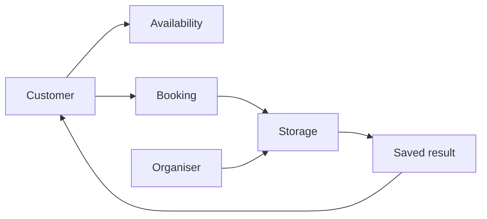

# P01 — Ticket booking project baseline

## Stakeholders and scope
Claire needs an accurate confirmed-booking list. Alex and Emma need honest availability and saved results. One fictional concert has 20 unnumbered tickets, one per customer, no payment.

## Actions and rules
- Search availability, request one ticket, retrieve the saved result.
- Confirmed bookings must never exceed capacity; one ticket per customer.
- Last ticket with two overlapping requests: one Confirmed, one Sold out, total 20.

## Quality concerns
Correctness under concurrency; duplicate clicks; recovery from an uncertain response.

Terms: capacity, availability, confirmed booking, saved result.

Proposed review improvement: distinguish a click (a request) from the durable booking result; test duplicate clicks explicitly. Actual peer-review comments and personal reflection are not fabricated and should be completed by the student.
