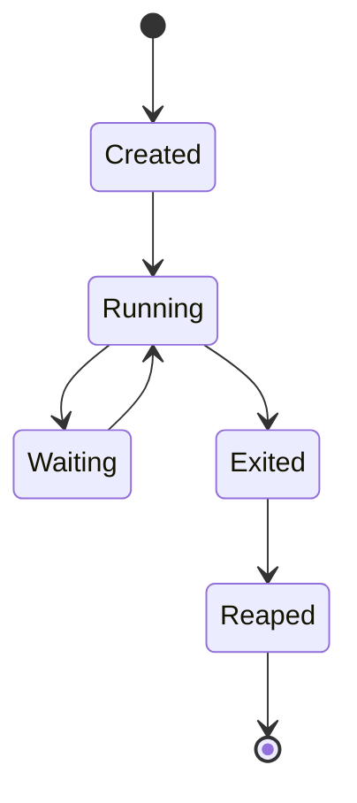

# P02 worksheet

User application → file request → system call → kernel → file system → result. A process has a PID and resources; a thread is one execution path. A parent starts the child using subprocess.Popen; wait() blocks until it exits. Child runs CPU work, waits for input, writes synthetic data, exits. POSIX wait reaps the child.

ADR: choose subprocess with sys.executable, inherited stdin/stdout and a wait/cleanup path because it is portable. Tradeoff: parent blocks. On Windows the process lifecycle differs from POSIX reaping.

Actual evidence: see output/child-result.txt after your run, and record PID, command, observed output and changed exit result.
